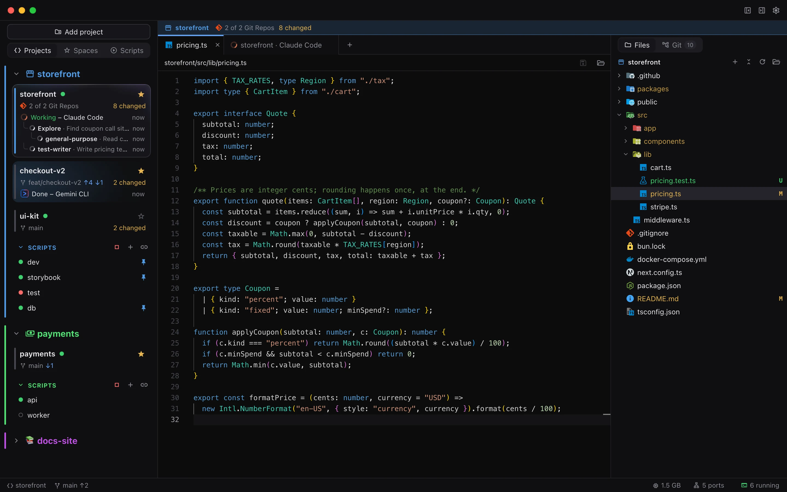
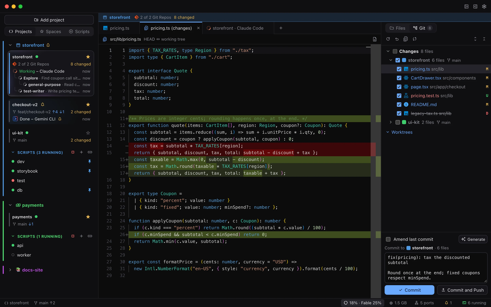

<p align="center"></p>

<h1 align="center">Aira</h1>

<p align="center"><sub>“aye-ra”</sub></p>

<p align="center">
A Mac code editor for working on many projects at once.<br>
Dev servers, coding agents and git for every repo you have open, in one window.
</p>

<p align="center"><a href="https://aira.codevry.com/">Website</a> · <a href="https://aira.codevry.com/features.html">Features</a> · <a href="https://aira.codevry.com/guide.html">Guide</a> · <a href="#build">Build</a></p>



## Features

- **Projects and spaces.** Open many folders at once; each project gets its own color and icon. Spaces (the root, a nested package, a git worktree) keep their own tabs, file tree and Git view.
- **Coding agents.** Start Claude Code, Codex, Gemini CLI, OpenCode, Aider, Cursor Agent, Copilot CLI, Amp, Goose, Qwen Code, Crush or Factory Droid from the tab bar. Each space shows whether its agents are working, need input or are done, Claude Code's subagents appear as a tree, and macOS tells you when an agent finishes.
- **Scripts.** Every project gets a scripts window. One Start button runs your usual dev servers; a failed script keeps its output and exit code.
- **Git.** One commit panel for every repo in a project, nested repos and worktrees included. Diff against HEAD, commit, push, and generate commit messages with the AI provider, local model or agent CLI you choose. API keys stay in the macOS Keychain.
- **Ports and memory.** See which process holds a port and free it; see each terminal's memory.
- **Editor.** Monaco, a file tree with git colors, xterm.js terminals, dark and light themes.



## Build

Needs macOS, [Bun](https://bun.sh), [Rust](https://rustup.rs) and the Xcode Command Line Tools.

```sh
bun install
bun tauri dev     # run the app
bun tauri build   # Aira.app in src-tauri/target/release/bundle/macos
```

Rust tests: `cd src-tauri && cargo test`

Coding agents aren't bundled: install the CLIs you use and Aira finds them on your PATH.

Screenshots in `docs/screenshots` and the recordings in `docs/media` come from `bun run screenshots` and `bun run clips` (demo data; needs `bun run dev` running and ffmpeg for clips, see `scripts/screenshots/`).

## Status

Early preview (v0.1), macOS only. Built with Tauri 2, React, Monaco and xterm.js.

## License

[MIT](LICENSE)
